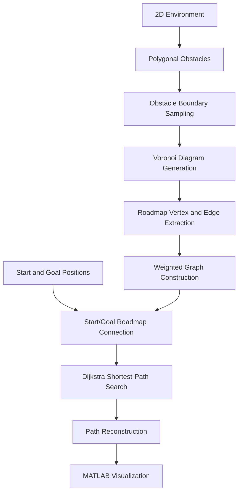

# Voronoi Diagram-Based Roadmap Motion Planning

A MATLAB implementation of roadmap-based robot motion planning using **Voronoi diagrams, computational geometry, and graph-based shortest-path search**.

The project explores how a robot can navigate a two-dimensional environment containing polygonal obstacles by constructing a geometric roadmap and searching for a route between a start and goal position.

> **Project status:** Existing MATLAB implementation. The repository is being organized for reproducibility and documentation. Runtime validation and collision-free path guarantees have not yet been independently verified.

---

## Overview

Motion planning is a fundamental problem in robotics: given a starting position, a destination, and an environment containing obstacles, determine a route that allows a robot to reach its destination.

This project uses a Voronoi-based roadmap approach.

A Voronoi diagram partitions a plane into regions according to their nearest generating points. Its edges represent locations that are equidistant from nearby obstacle-related points. These edges can be used to construct a roadmap through relatively open regions of the environment.

The resulting roadmap is represented as a weighted graph. Dijkstra's shortest-path algorithm is then used to calculate a route between the selected start and goal positions.

### Key concepts

- **Computational geometry:** Geometric representation of obstacles and Voronoi structures.
- **Voronoi diagrams:** Generation of geometric roadmap candidates.
- **Graph modeling:** Representation of roadmap vertices and edges.
- **Shortest-path search:** Dijkstra's algorithm for route computation.
- **MATLAB visualization:** Display of obstacle environments, roadmap structures, and planned paths.

---

## System Architecture

The system follows a geometry-to-graph planning pipeline.



### Component responsibilities

| Component | Responsibility |
|---|---|
| `Obstacle_Draw.m` | Interactive creation of polygonal obstacle environments and boundary sampling |
| `Get_Voronoi.m` | Generation of Voronoi structures and extraction of roadmap edges |
| `Final_Path.m` | Construction of the roadmap graph and computation/visualization of the route |
| `dijkstra.m` | Shortest-path computation on the weighted graph |
| `data/obstacles/` | Stored obstacle configurations and associated images |

### Planning workflow

1. **Environment creation:** Define polygonal obstacles in a two-dimensional workspace.
2. **Boundary sampling:** Generate points along obstacle boundaries.
3. **Voronoi construction:** Use MATLAB's `voronoin` functionality to generate the Voronoi diagram.
4. **Roadmap extraction:** Extract candidate vertices and edges from the generated diagram.
5. **Graph construction:** Represent roadmap connections as a weighted graph using Euclidean distances.
6. **Route computation:** Apply Dijkstra's algorithm to search for a shortest route through the graph.
7. **Visualization:** Display the environment, roadmap, and computed route.

---

## Repository Structure

```text
voronoi-roadmap-motion-planning/
│
├── src/
│   ├── dijkstra.m
│   ├── Final_Path.m
│   ├── Get_Voronoi.m
│   └── Obstacle_Draw.m
│
├── data/
│   └── obstacles/
│       ├── Obstacle_config001.jpg
│       ├── Obstacle_config001.mat
│       ├── ...
│       ├── Obstacle_config006.jpg
│       └── Obstacle_config006.mat
│
├── docs/
│   └── original-readme.txt
│
├── tests/
│
├── results/
│   └── figures/
│
├── .gitignore
└── README.md
```

---

## Requirements

- MATLAB or MATLAB Online.
- MATLAB functions used by the implementation, including:
  - `voronoin`
  - `ginput`
  - `plot`
  - `load`
  - `save`

No external package installation is currently documented as necessary.

---

## Getting Started

### 1. Clone the repository

```bash
git clone https://github.com/YOUR_USERNAME/voronoi-roadmap-motion-planning.git

cd voronoi-roadmap-motion-planning
```

### 2. Open the project in MATLAB

Open the repository folder in MATLAB or upload it to MATLAB Drive when using MATLAB Online.

Add the source directory to the MATLAB path:

```matlab
addpath('src');
```

### 3. Create an obstacle environment

Run:

```matlab
Obstacle_Draw
```

The original workflow uses interactive mouse input to define polygonal obstacles.

Follow the prompts to draw the environment and save its configuration.

### 4. Generate the Voronoi roadmap

Open `Get_Voronoi.m`.

Configure the obstacle dataset to use the desired environment. The original implementation refers to an `Obstacle_Files` directory; update its loading path to match this repository's `data/obstacles/` directory if necessary.

Run:

```matlab
Get_Voronoi
```

Select the start and goal positions when prompted.

### 5. Compute the path

Without closing the figure or clearing the workspace, run:

```matlab
Final_Path
```

The original workflow relies on variables created by the preceding script, so execute the scripts in the stated order.

---

## Demo

### Interactive MATLAB demonstration

The intended demonstration consists of:

1. A two-dimensional environment containing polygonal obstacles.
2. The generated Voronoi diagram and roadmap.
3. User-selected start and goal positions.
4. The shortest path computed through the roadmap.

### Screenshots

Add your actual MATLAB output images to `results/figures/` and update the image references below.

**1. Obstacle environment**


**2. Generated Voronoi roadmap**


**3. Computed path**


### Demo GIF

Once a screen recording has been captured and converted into a GIF, save it as:

`results/figures/demo.gif`

Then embed it here:


*The image and GIF paths above are placeholders until the corresponding demonstration files are added.*

---

## Algorithms and Technical Details

### Voronoi-based roadmap generation

The implementation uses MATLAB's `voronoin` function to construct a Voronoi diagram from a collection of two-dimensional points.

The diagram provides geometric structures that can be used to identify candidate routes through the workspace.

### Weighted graph representation

The roadmap is represented as a graph:

\[
G=(V,E)
\]

where:

- \(V\) represents roadmap vertices.
- \(E\) represents connections between vertices.
- Each edge is assigned a weight based on Euclidean distance.

For two connected vertices \(u\) and \(v\):

\[
w(u,v)=\sqrt{(x_u-x_v)^2+(y_u-y_v)^2}
\]

### Dijkstra's shortest-path algorithm

Dijkstra's algorithm searches the weighted roadmap for a minimum-cost route from the selected source to the destination.

The objective is:

\[
P^*=\arg\min_{P\in\mathcal{P}(s,g)}
\sum_{e\in P}w(e)
\]

where \(\mathcal{P}(s,g)\) represents the candidate graph paths between the start vertex \(s\) and goal vertex \(g\).

---

## Current Limitations

The current implementation is an academic prototype and has limitations that should be considered before using it in a real robotic system.

- The implementation uses MATLAB scripts and shared workspace variables.
- Start and goal connections to the roadmap need additional geometric validation.
- Voronoi vertices at infinity require careful handling during edge extraction.
- Collision checking of roadmap edges and connecting segments needs to be verified.
- The current implementation has not been benchmarked against alternative planning algorithms.
- Robust handling of invalid environments, disconnected roadmaps, and degenerate geometry requires further testing.

A computed graph path should not automatically be interpreted as a verified collision-free robot trajectory.

---

## Future Improvements

Potential engineering extensions include:

- Modularizing the MATLAB scripts into reusable functions.
- Implementing robust polygon and segment intersection checks.
- Filtering infinite and invalid Voronoi vertices.
- Validating every roadmap edge against obstacles.
- Improving start and goal connection strategies.
- Adding A* as an alternative graph-search algorithm.
- Comparing planning performance across different obstacle configurations.
- Adding automated tests and reproducible benchmark scenarios.
- Creating a recorded end-to-end demonstration.

---

## References and Attribution

This repository preserves an existing academic MATLAB implementation and its associated documentation.

The original project documentation identifies the work as a Voronoi-based roadmap motion-planning project associated with an Artificial Intelligence course at IIT Kanpur.

The original `dijkstra.m` source also contains attribution to:

- Xiaodong Wang — MATLAB File Exchange submission 5550 (2004).
- Meral Shirazipour — modifications/simplifications documented in the source comments (2009).

Please consult the original source comments and documentation for full provenance and licensing details. This repository should not be interpreted as claiming sole original authorship of the inherited implementation.

---

## License

No license is currently specified. The original source code's licensing and redistribution permissions should be verified before assigning a license to this repository.

---

## Author

**Aditya Kumar**

B.Tech — Computer Science and Engineering (Artificial Intelligence and Machine Learning)

GitHub: https://github.com/YOUR_USERNAME

---

*This project is intended for educational and experimental exploration of computational geometry, graph algorithms, and robot motion planning.*
